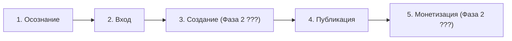

# CJM — карта пути клиента

> Строится из `personas.md` + `use-cases.md` + user flow.
> Персона: **P-1 «Мем-энтузиаст»**. Контур: B2C (допущение), РФ (допущение).

## Таблица этапов

| Этап | Touchpoint | Действие | Эмоция | Боль | Возможность |
|---|---|---|---|---|---|
| 1. Осознание | Соцсеть, мем | Увидел мем, хочет свой вариант | 🙂 интерес | Не знает, где сделать быстро | Шаблон в один клик |
| 2. Вход | Приложение | Открывает, выбирает шаблон | 😐 нейтрально | Много шагов / редакторов | Простой конструктор |
| 3. Создание | Конструктор | Вводит три фазы, включая «Фазу 2» | 😟 недоумение | **«Фаза 2» пустая — что писать?** | Подсказка / готовые варианты |
| 4. Публикация | Шаринг | Сохраняет и делится | 🙂 удовольствие | Риск нарушить IP | Пометка о правомерности |
| 5. Монетизация | Премиум | Думает о подписке | 😟 сомнение | Непонятно, за что платить (Фаза 2) | Ясная ценность тарифа |

## Визуальная лента

## Нарратив (от лица персоны)

Я увидел мем и захотел свой. Открыл приложение, выбрал шаблон — всё быстро.
Но на третьей фазе завис: «Фаза 2» пустая, а именно в ней смысл. Если мне
подскажут — я дойду до публикации; если нет — брошу.

## Источники

- Персона: `personas.md` (P-1)
- Сценарии: `use-cases.md` (UC-1, UC-2, UC-3)
