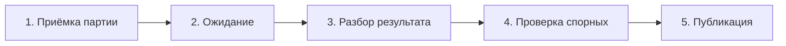

# CJM — карта пути клиента

> Строится из `personas.md` + `jtbd.md` + `use-cases.md` + user flow (см.
> `skills/diagram-generation/SKILL.md`).
> Персона: **P-1 «Специалист по качеству каталога»**. Контур: B2B, Россия.

## Таблица этапов

| Этап | Touchpoint | Действие | Эмоция | Боль | Возможность |
|---|---|---|---|---|---|
| 1. Приёмка партии | Веб-UI / API | Загружает CSV/XLSX | 😐 | Партия большая, всё вручную | Batch-job + прогресс |
| 2. Ожидание | UI статус | Смотрит прогресс | 🙂 | — | SSE / прогресс-бар |
| 3. Разбор результата | UI таблица | Смотрит accepted / review | 🙂 | Не доверяет «магии» | Цитата-подсветка source_span |
| 4. Проверка спорных | Очередь review | Принимает / исправляет low-confidence | 😟→🙂 | Непонятно, почему значение | Confidence + explain |
| 5. Публикация | Каталог | Значения идут в карточку | 🙂 | — | Правки человека → в разметку |

## Визуальная лента

## Нарратив (от лица персоны)

Приходит партия на 500 карточек. Раньше я открывал каждую и переносил
характеристики руками — вечер уходил, а бренд всё равно иногда был пустым.
Теперь я вижу таблицу: большинство значений уже с уверенностью и цитатой,
а мне остаётся просмотреть спорные. Теряюсь там, где уверенность низкая и
непонятно почему — поэтому цитата-подсветка критична.

## Источники

- Персона: `personas.md` (P-1)
- Работы: `jtbd.md` (J-1)
- Сценарии: `use-cases.md` (UC-2, UC-3)
