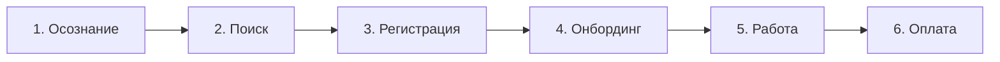

# CJM — карта пути клиента

> Строится из `personas.md` + `jtbd.md` + `use-cases.md` + user flow.
> Персона: **P-1 «Соло-предприниматель»**. Контур: B2B SaaS, РФ **[допущение]**.

## Таблица этапов

| Этап | Touchpoint | Действие | Эмоция | Боль | Возможность |
|---|---|---|---|---|---|
| 1. Осознание | Мессенджер | Потерял лид в переписке | 😟 | Нет системы, всё в голове | Боль «теряю деньги» |
| 2. Поиск | Поиск/рекомендации | Ищет лёгкий CRM | 😐 | Тяжёлые CRM пугают | Обещание «5 минут до первого контакта» |
| 3. Регистрация | Лендинг | Вводит email | 🙂 | Боязнь сложной настройки | Онбординг без конфигурации |
| 4. Онбординг | Мастер «первый контакт» | Заводит контакт | 🙂 | Не понимает, что дальше | Мгновенная ценность (J-1) |
| 5. Работа | Воронка, задачи | Ведёт сделки | 🙂 / 😐 | Забывает следующий шаг | Напоминания (J-2, J-4) |
| 6. Оплата | Тарифы | Упирается в лимит | 😟 / 🙂 | Страх платить за лишнее | Понятный freemium → подписка (J-6) |

## Визуальная лента

## Нарратив (от лица персоны)

Веду клиентов в переписке и таблице; один лид теряется, пока отвечаю
другому. Хочу занести контакт с телефона за секунды и не забыть следующий
шаг. Если первый контакт заводится легко — остаюсь; если снова «настройте
поля» — ухожу.

## Источники

- Персона: `personas.md` (P-1)
- Работы: `jtbd.md` (J-1, J-2, J-6)
- Сценарии: `use-cases.md` (UC-1, UC-2, UC-6)
