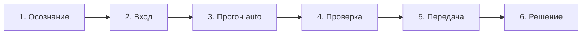

# CJM — карта пути клиента

> Строится из `personas.md` + `jtbd.md` + `use-cases.md` + user flow.
> Персона: **P-1 «Заказчик продукта»**. Контур: B2B, локальный запуск.

## Таблица этапов

| Этап | Touchpoint | Действие | Эмоция | Боль | Возможность |
|---|---|---|---|---|---|
| 1. Осознание | идея в голове | Формулирует задачу одной строкой | 🙂 | Непонятно, что из идеи следует, а что додумано | Быстрый вход без анкеты |
| 2. Вход | `prompts/start.md` | Вставляет строку и выбирает auto | 😐 | Боится, что ИИ начнёт фантазировать | Явные метки гипотез |
| 3. Прогон | роли и гейты | Наблюдает, как собираются артефакты | 😟 | Нет вопросов — неясно, что решено за него | Список допущений и открытых вопросов |
| 4. Проверка | `validation-report.md` | Читает, что подтверждено и что нет | 🙂 | Отчёт большой, нужно время | Итог из 14 утверждений и 8 находок |
| 5. Передача | `traceability-matrix.md`, `spec.md` | Отдаёт спецификацию архитектору | 🙂 | Нужно объяснять, что закрыто, а что разрыв | Статусы implemented / draft |
| 6. Подтверждение | `human-oversight-plan.md` | Подтверждает или отменяет восемь допущений | 🙂 | Допущения приняты моделью, их надо проверить | Список «что модель додумала» |

## Визуальная лента

## Нарратив (от лица персоны)

Я приношу одну строку и через прогон получаю спецификацию. Рад, что не нужно
заполнять анкету, но тревожусь: вопросов мне не задали, значит часть решений
принята за меня. Иду в `validation-report.md` и `hallucination-log.md` — там
видно, что подтверждено цитатой, а что осталось допущением. Дальше смотрю
трассировку: какие требования уже закрыты реализацией, а какие стали
разрывами v0.3. В конце подтверждаю или отменяю восемь допущений: прогон не
остановился, но всё, что модель решила за меня, видно явно.

## Источники

- Персона: `personas.md` (P-1)
- Работы: `jtbd.md` (J-1, J-5)
- Сценарии: `use-cases.md` (UC-1, UC-5)
