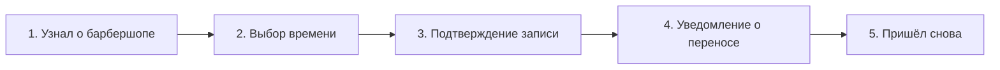

# CJM — карта пути клиента

> Источник: ответ роли designer, отдельный вызов CJM (`qwen3:8b`, temperature 0, top_p 1, num_ctx 16384, think false). Сборка — оркестратор: таблицы, ID и ссылки; содержание не дописывалось. Пробелы в ответе модели помечены явно.
> Персона: **P-1 «Клиент барбершопа»**. Контур: B2B2C.

## Таблица этапов

| Этап | Touchpoint | Действие | Эмоция | Боль | Возможность |
|---|---|---|---|---|---|
| 1. Узнал о барбершопе | Соцсети/реклама | Посмотрел описание услуг | 🙂 | Неясно, какие услуги доступны | Уточнить детали через чат |
| 2. Выбор времени | Календарь бронирования | Выбрал удобное время | 😐 | Нет возможности выбрать дату | Добавить фильтр по датам |
| 3. Подтверждение записи | Потверждение через email | Получил подтверждение | 🙂 | Нет статуса записи | Добавить статус в личном кабинете |
| 4. Уведомление о переносе | Системное уведомление | Получил уведомление о переносе | 😟 | Нельзя отменить запись | Добавить возможность отмены |
| 5. Пришёл снова | Посещение барбершопа | Получил услугу | 🙂 | Нет стандартных элементов | Добавить стандартные элементы интерфейса |

## Визуальная лента

## Нарратив (от лица персоны)

Я хотел записаться на стрижку, но не понял, какие услуги доступны. После выбора времени мне не хватило возможности выбрать дату. Подтверждение пришло, но я не знал статус записи. Когда мне пришлось переносить время, я не мог отменить запись. Теперь я пришёл снова, но интерфейс не удобен.

## Источники

- Персона: `personas.md` (P-1)
- Работы: `jtbd.md` (J-1)
- Сценарии: `use-cases.md` (UC-1)

> Ответ дизайнера в формате роли не содержит поля CJM: карта собрана отдельным
> вызовом с явной схемой. Это дефект промпта роли (находка `WC-6`).
