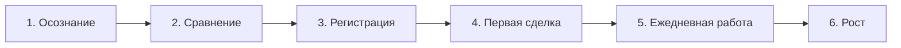

# CJM — карта пути клиента

> Строится из `personas.md` + `jtbd.md` + `use-cases.md` + user flow.
> Персона: **P-1 «Аня»** (менеджер по продажам). Контур: B2B, РФ, команды 2–20.

## Таблица этапов

| Этап | Touchpoint | Действие | Эмоция | Боль | Возможность |
|---|---|---|---|---|---|
| 1. Осознание | реклама/совет коллег/поиск | узнаёт, что CRM может упростить продажи | 🙂 | «в таблицах уже путаюсь» | быстрый оффер «первая сделка за 10 минут» |
| 2. Сравнение | сайты amoCRM/Bitrix24/наш | сравнивает цену и сложность | 😐 | «дорого и перегружено для нас» | прозрачные дешёвые тарифы, демо за 2 клика |
| 3. Регистрация | лендинг → триал | создаёт аккаунт, приглашает команду | 😐 | лишние поля, непонятно с чего начать | guided-онбординг, пустое состояние с подсказкой |
| 4. Первая сделка | воронка | создаёт сделку ≤10 мин | 🙂 | боится «опять долго настраивать» | time-to-value ≤ 10 мин (UC-1, FR-14) |
| 5. Ежедневная работа | карточка клиента, мессенджеры, звонки | ведёт переписку и задачи из одного места | 🙂/😐 | данные снова размазаны, если интеграции не подключены | единая история (UC-2), напоминания (UC-3), PWA (UC-4) |
| 6. Рост | отчёты | руководитель смотрит воронку | 🙂 | непонятно, где теряются деньги | отчёты (UC-5), автоматизация (UC-9) |

## Визуальная лента

## Нарратив (от лица персоны)

Я менеджер в небольшом стартапе и веду десятки лидов в почте, Telegram и по телефону.
Когда клиент пишет, я судорожно ищу, о чём мы говорили. Большие CRM пугают ценой и
настройкой. Мне нужно, чтобы за десять минут я завела сделку и уже видела пользу.

## Источники

- Персона: `personas.md` (P-1)
- Работы: `jtbd.md` (J-1, J-2, J-3, J-4)
- Сценарии: `use-cases.md` (UC-1, UC-2, UC-3, UC-4, UC-5, UC-9)
