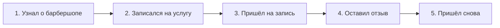

# CJM — карта пути клиента

> Источник: ответ роли designer, отдельный вызов CJM (`qwen3:8b`, temperature 0, top_p 1, num_ctx 16384, think false). Сборка — оркестратор: таблицы, ID и ссылки; содержание не дописывалось. Пробелы в ответе модели помечены явно.
> Персона: **P-1 «Клиент барбершопа»**. Контур: B2C.

## Таблица этапов

| Этап | Touchpoint | Действие | Эмоция | Боль | Возможность |
|---|---|---|---|---|---|
| 1. Узнал о барбершопе | Соцсети | Посмотрел отзывы и расписание | 🙂 | Не уверен в качестве услуг | Позитивные отзывы |
| 2. Записался на услугу | Мобильное приложение | Выбрал время и мастера | 😐 | Сложно найти свободное время | Гибкое расписание |
| 3. Пришёл на запись | Барбершоп | Получил услугу | 🙂 | Ожидал более быстрого обслуживания | Улучшенный процесс обслуживания |
| 4. Оставил отзыв | Мобильное приложение | Оценил качество и сервис | 🙂 | Не хватает функции быстрого отзыва | Внедрение быстрого отзыва в приложении |
| 5. Пришёл снова | Барбершоп | Выбрал новую услугу | 🙂 | Не хватает рекомендаций по услугам | Персонализированные рекомендации |

## Визуальная лента

## Нарратив (от лица персоны)

Клиент остался доволен качеством услуг и удобством записи, но ожидает улучшения процесса обслуживания и рекомендаций.

## Источники

- Персона: `personas.md` (P-1)
- Работы: `jtbd.md` (J-1)
- Сценарии: `use-cases.md` (UC-1)

> Ответ дизайнера в формате роли не содержит поля CJM: карта собрана отдельным
> вызовом с явной схемой. Это дефект промпта роли (находка `WC-6`).
