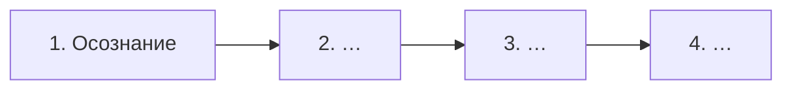

# CJM — карта пути клиента

> Строится из `personas.md` + `jtbd.md` + `use-cases.md` + user flow (см.
> `skills/diagram-generation.md`).
> Персона: **P-? «…»**. Контур: …

## Таблица этапов

| Этап | Touchpoint | Действие | Эмоция | Боль | Возможность |
|---|---|---|---|---|---|
| 1. Осознание | … | … | 🙂 / 😐 / 😟 | … | … |
| 2. … | … | … |  |  |  |
| 3. … | … | … |  |  |  |

## Визуальная лента

## Нарратив (от лица персоны)

2–3 строки: что видит, что чувствует, где теряется.

## Источники

- Персона: `personas.md` (P-?)
- Работы: `jtbd.md` (J-?)
- Сценарии: `use-cases.md` (UC-?)
